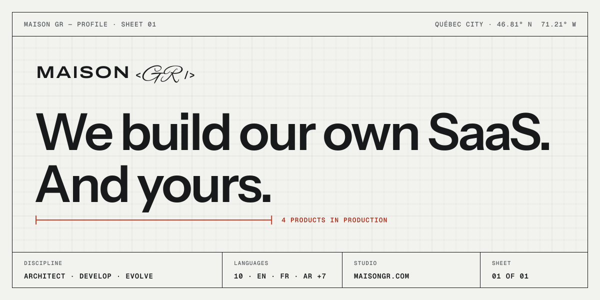
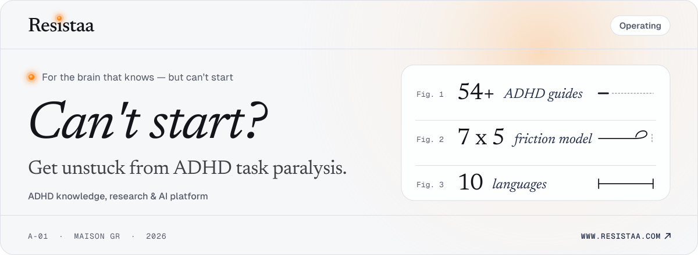
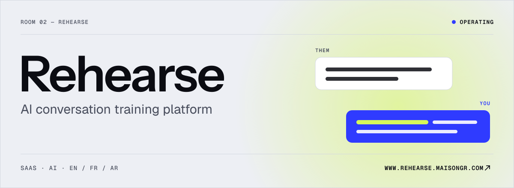
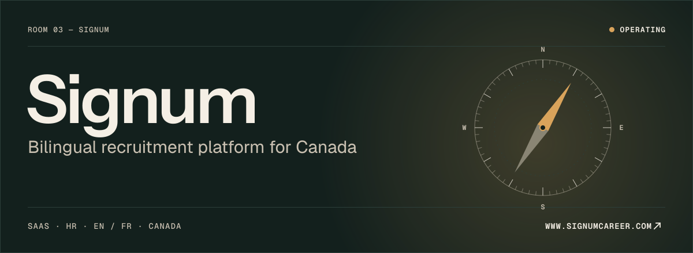
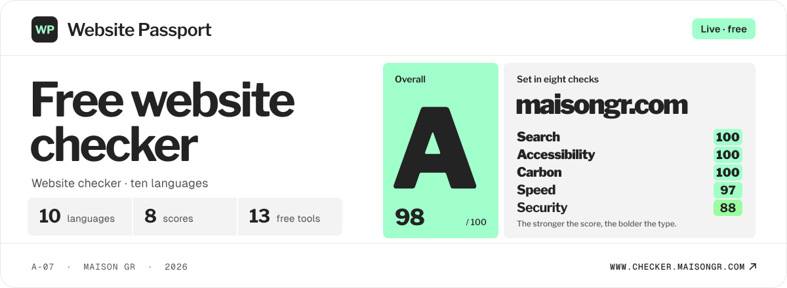

<a href="https://www.maisongr.com">
  <picture>
    <source media="(prefers-color-scheme: dark)" srcset="https://raw.githubusercontent.com/maison-gr/.github/main/profile/assets/header-dark.svg">
    
  </picture>
</a>

 

Maison GR is a digital product studio in Québec City. We design, build and run our own SaaS, and we build yours with the same care.

 

### In production

**[Resistaa](https://www.resistaa.com)** — An ADHD platform in ten languages that helps people understand the block, trust what they read, and begin with one realistic action.

 

**[Rehearse](https://www.rehearse.maisongr.com)** — Practise the raise, the breakup, the confrontation with an AI that plays the real person, then see exactly where you lost ground.

 

**[Signum](https://www.signumcareer.com)** — Hiring, explained. A bilingual platform connecting Canadian candidates and employers through explainable matching and a built-in ATS.

 

**[Website Passport](https://www.checker.maisongr.com)** — A free website checker in ten languages, with no account: enter an address and the site is set in type, each score in a weight that matches it. Eight scores, a full report and thirteen free tools.

 

### Open source

The tools we build with, published on npm and held to the same standard as our clients' products: tested on every change, scanned, and released with npm provenance. [maisongr.com/open-source](https://www.maisongr.com/en/open-source)

**[maisongr-skills](https://github.com/maison-gr/maisongr-skills)** — Engineering discipline for AI coding agents. Seven principles and thirteen skills that make an agent understand before it builds, keep its changes small, and prove the result, with receipts that check what it reports and stop the dev servers it forgot. For Claude Code, Codex, Cursor, GitHub Copilot and Gemini CLI. MIT licensed. `npx maisongr-skills`

**[maisongr-sitemap](https://github.com/maison-gr/maisongr-sitemap)** — One sitemap, two readers: the XML search engines need, and a page in your site's own design for people, with no XSLT, which browsers are removing. One command finds your pages, dates each one from Git and reads your theme. For Next.js, Astro, SvelteKit, Nuxt and Express. MIT licensed. `npx maisongr-sitemap init`

 

---

[maisongr.com](https://www.maisongr.com) · [hello@maisongr.com](mailto:hello@maisongr.com) · Québec City, Canada
